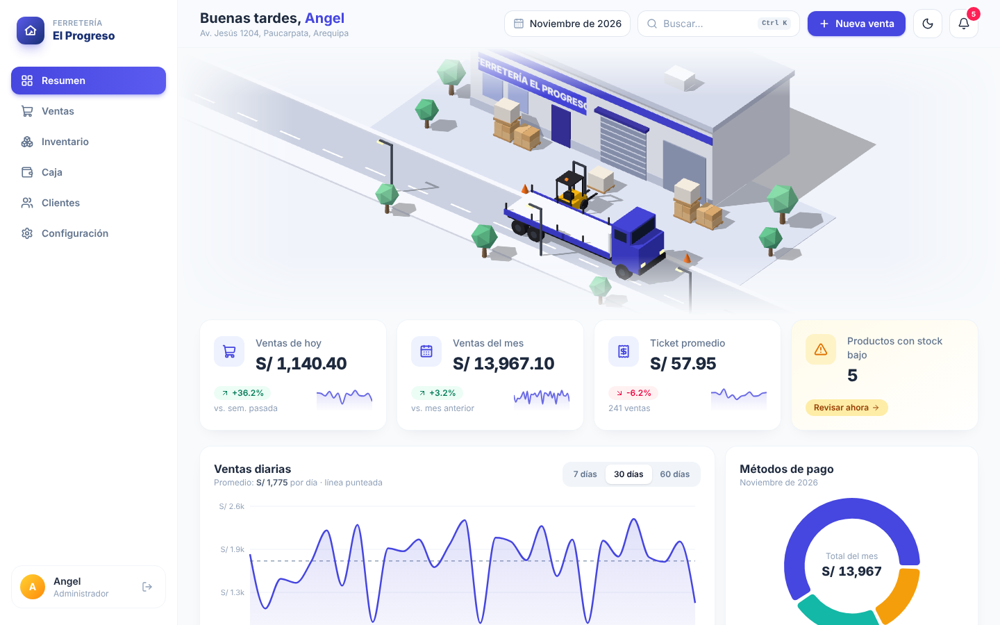
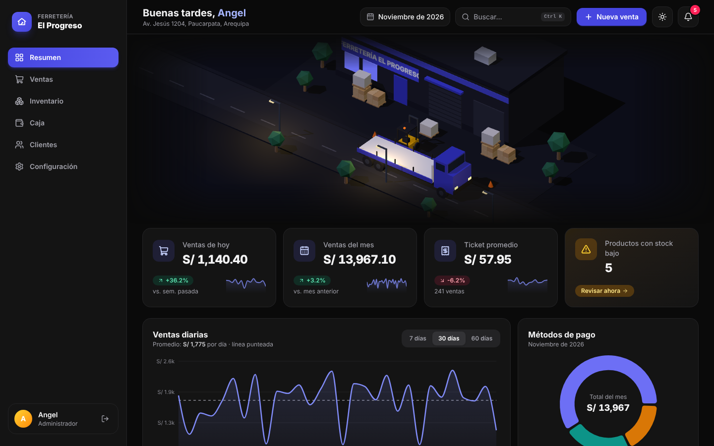
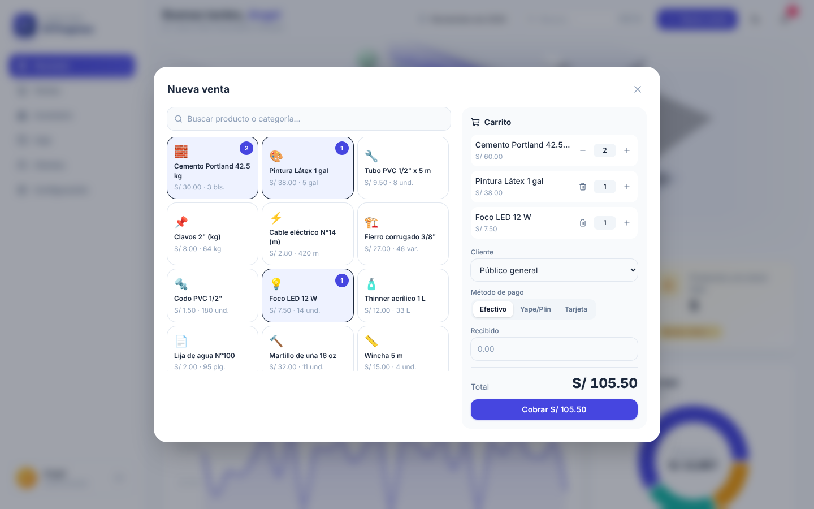
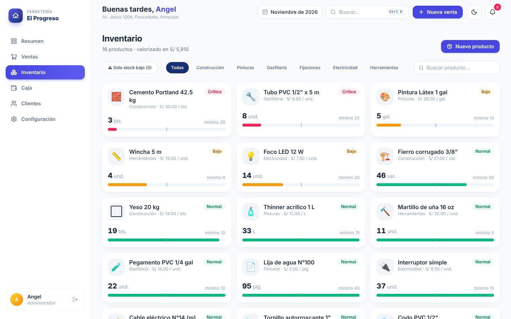
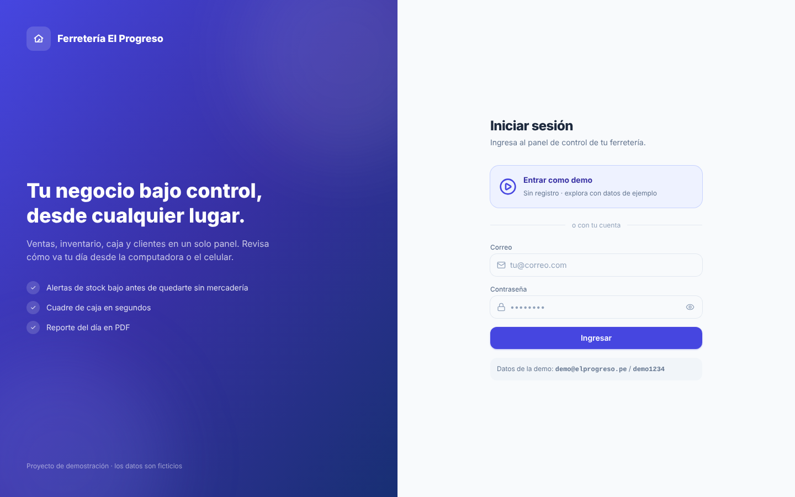
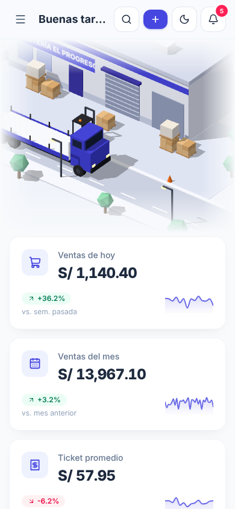

# Ferretería El Progreso · Panel de control

Sistema web para el dueño de un negocio local: **ventas, inventario, caja y clientes** en un solo panel, con punto de venta, reporte diario en PDF, búsqueda rápida (Ctrl + K), modo oscuro y una ilustración 3D animada del patio de carga.

> **Demo:** entra con el botón **"Entrar como demo"** o con `demo@elprogreso.pe` / `demo1234`.
> Los datos son ficticios. Lo que registres se guarda en tu navegador durante el día.



| Modo oscuro | Nueva venta |
|---|---|
|  |  |

| Inventario | Inicio de sesión | Celular |
|---|---|---|
|  |  |  |

## Funcionalidades

- **Inicio de sesión** con acceso demo, rutas protegidas y cierre de sesión.
- **Punto de venta (Nueva venta)**: catálogo con búsqueda, carrito con cantidades, cliente, método de pago (Efectivo, Yape/Plin, Tarjeta) y cálculo del vuelto. Al cobrar:
  - descuenta el stock,
  - suma la boleta al historial con numeración correlativa,
  - registra el ingreso en caja si es en efectivo,
  - actualiza KPIs, gráficos y alertas al instante.
- **Resumen**: ilustración 3D animada (Three.js) del patio de carga; KPIs con variación; ventas diarias (7/30/60 días); métodos de pago; top 5 de productos; alertas de reposición.
- **Ventas**: historial con filtros, paginación, detalle de boleta, exportación a CSV y **reporte del día en PDF**.
- **Inventario**: nuevo producto, ajuste de stock (entrada de mercadería o salida/merma), filtro de stock bajo, categorías y búsqueda.
- **Caja**: apertura, ingresos, egresos, registro de egresos y cierre con cálculo de sobrante o faltante.
- **Clientes**: nuevo cliente, compras, deudas y registro de pagos (el cobro entra a caja).
- **Configuración**: datos del negocio, preferencias, usuarios y restablecer la demo.
- **Búsqueda rápida (Ctrl + K)**: productos, clientes, boletas, páginas y acciones.
- **Notificaciones** tipo toast, **modo claro/oscuro** y diseño **responsive**.

## Animaciones

- Transiciones entre páginas con Framer Motion (`AnimatePresence`) y entrada escalonada.
- Indicadores que se deslizan (`layoutId`) en el menú, pestañas y buscador.
- Rebote suave al presionar, modales con resorte, contadores animados.
- Escena 3D isométrica: un montacargas carga pallets en el camión, el camión se va y llega otro, en bucle. Se pausa fuera de pantalla y se carga aparte.
- Respeta `prefers-reduced-motion`.

## Stack

React 19 · TypeScript · Vite · Tailwind CSS v4 · Framer Motion · Three.js · Recharts · jsPDF · React Router · Lucide

## Cómo correrlo

```bash
npm install
npm run dev      # http://localhost:5173
npm run build    # compilación de producción en /dist
```

## Despliegue

**Vercel (recomendado):** sube el proyecto a GitHub → en vercel.com, *Add New → Project* → importa el repositorio → *Deploy*. `vercel.json` ya trae la configuración.

**GitHub Pages:** el workflow `.github/workflows/deploy.yml` publica la demo en cada push a `main`. Actívalo en *Settings → Pages → Source: GitHub Actions*.

## Estructura

```
src/
├── components/   Layout, Page (transiciones), Modal, Toaster, PatioCarga, ui
│   └── modales/  NuevaVenta (POS), NuevoProducto, NuevoCliente, Buscador (Ctrl+K)
├── data/
│   ├── mock.ts   Datos de ejemplo deterministas (relativos a la fecha actual)
│   └── store.ts  Estado, acciones (vender, ajustar stock, cobrar…) y persistencia
├── lib/          Cálculos (stats), reporte PDF, colores de gráficos por tema
├── scene/        patio.ts: escena 3D del patio de carga (Three.js)
└── pages/        Login, Resumen, Ventas, Inventario, Caja, Clientes, Configuración
supabase/
└── schema.sql    Tablas, seguridad por negocio (RLS) y función registrar_venta
```

## Llevarlo a producción con Supabase

La demo guarda los datos en el navegador. Para usarlo con un negocio real:

1. Crea un proyecto en [supabase.com](https://supabase.com) y ejecuta `supabase/schema.sql` en el *SQL Editor*. Crea las tablas, las políticas de seguridad (cada dueño solo ve su negocio) y la función `registrar_venta`, que guarda la venta, descuenta stock y registra la caja en una sola operación.
2. Copia `.env.example` como `.env.local` con la URL y la clave *anon* del proyecto.
3. Instala el cliente (`npm i @supabase/supabase-js`) y reemplaza las acciones de `src/data/store.ts` por llamadas a Supabase. La interfaz no cambia porque todas las pantallas usan esas mismas acciones.
4. Cambia el login demo por `supabase.auth.signInWithPassword`.
